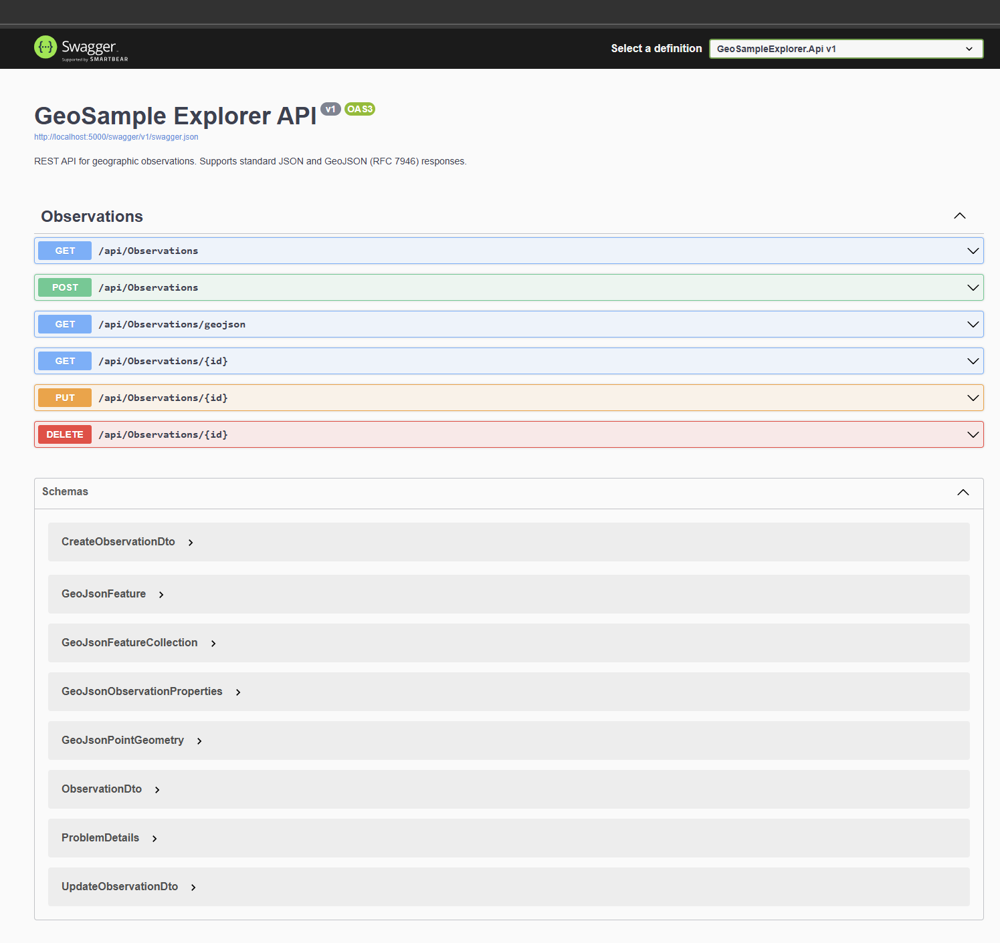

# GeoSample Explorer

A full-stack web application for managing and visualizing geographic observations (soil samples, water tests, rock formations, etc.) on an interactive map. Built as a portfolio project to demonstrate modern web development skills and geospatial data handling.

---

## Overview

GeoSample Explorer allows users to browse, filter, and manage field observations with coordinates. Each observation can be viewed on a map, edited, or exported as GeoJSON for use in GIS tools. The project showcases a clean separation between frontend and backend, REST API design, and integration with mapping libraries.

---

## Technologies

| Layer | Stack |
|-------|--------|
| **Frontend** | React 18, TypeScript, Vite, Leaflet, react-leaflet |
| **Backend** | ASP.NET Core 8 Web API, C# |
| **Database** | SQLite with Entity Framework Core |
| **Testing** | xUnit, WebApplicationFactory, EF Core InMemory |

---

## Architecture

```
┌─────────────────────────────────────────────────────────────────┐
│                     GeoSample Explorer                            │
├─────────────────────────────────────────────────────────────────┤
│  Frontend (React + Vite)          │  Backend (ASP.NET Core)      │
│  ├── MapView (Leaflet)           │  ├── ObservationsController   │
│  ├── ObservationList             │  ├── DTOs + GeoJSON models    │
│  ├── FiltersPanel                │  ├── AppDbContext (EF Core)   │
│  ├── ObservationDetailCard       │  └── SQLite                   │
│  └── ObservationForm (CRUD)      │                               │
└─────────────────────────────────────────────────────────────────┘
```

- **Frontend** runs on port 5173; Vite proxies `/api` to the backend.
- **Backend** runs on port 5000; returns JSON and GeoJSON.
- **Database** is SQLite (file-based); connection string in `appsettings.json`.

---

## Features

- **Interactive map** – Leaflet map with markers; click to view details or select from list
- **Filtering** – Search by name, filter by type and region (debounced search, backend-driven)
- **CRUD** – Create, edit, and delete observations with validation (frontend + backend)
- **Detail view** – Selected observation shows name, type, region, coordinates, observed date, description
- **GeoJSON** – `GET /api/observations/geojson` returns RFC 7946 FeatureCollection for GIS integration
- **URL state** – Filter state synced to query string for sharing
- **Occupational-disease regions** – Separate read-only page of retained confirmed case counts by Finnish region and year, 2019–2023. It uses committed aggregates and does not call the API.

---

## Screenshots

### Main view – Map and observation list


*Map with observation markers, left panel with filters and list, and detail panel for selected sample.*

---

### API documentation – Swagger UI



*Interactive API documentation at `http://localhost:5000/swagger`.*

---

## Installation & Run

### Prerequisites

- **Node.js** 18+ and npm
- **.NET 8 SDK** (`global.json` stays on the 8.0 feature band)

### Backend

```bash
cd backend/GeoSampleExplorer.Api
dotnet ef database update
dotnet run
```

- API: `http://localhost:5000`
- Swagger: `http://localhost:5000/swagger`

### Frontend

```bash
cd frontend
npm install
npm run dev
```

- Regional counts: `http://localhost:5173/GeoSample-Explorer/worklife-regions.html`
- Observation app (needs the API): `http://localhost:5173/GeoSample-Explorer/observations.html`

### Tests

```bash
cd backend
dotnet test
```

```bash
cd frontend
npm test
```

The regional counts can be rebuilt from the pinned zip and compared with the committed files:

```bash
python scripts/verify_worklife_regions.py --zip path/to/occupational-diseases-data-20052026.zip
```

`--write` replaces `frontend/public/worklife/` after the same checksum check. A different file size or SHA-256 stops before writing.

### CI (GitHub Actions)

Workflows in `.github/workflows/`:

- **frontend-build.yml** – Tests and builds the frontend on push/PR to `main` or `develop` (when `frontend/` changes).
- **backend-build.yml** – Builds and tests the backend on push/PR (when `backend/` changes).
- **pages.yml** – Manual GitHub Pages publication. It is not run by a push.

---

## Environment Variables

| Variable | Location | Description |
|----------|----------|-------------|
| `VITE_API_BASE_URL` | `frontend/.env` | Backend base URL. Leave empty to use Vite proxy (`/api` → `localhost:5000`). |
| `ConnectionStrings:DefaultConnection` | `backend/.../appsettings.json` | SQLite connection string (default: `Data Source=geosample.db`). |
| `Cors:AllowedOrigins` | `backend/.../appsettings.*.json` | Allowed CORS origins (JSON array). Override in Azure App Service. |

Copy `frontend/.env.example` to `frontend/.env` and adjust if needed.

---

## Azure Deployment

### Frontend (Static Web Apps)

1. Create an Azure Static Web App (e.g. via Azure Portal or CLI).
2. Connect your GitHub repo; set **App location** to `frontend`.
3. Build settings:
   - **Build command:** `npm run build`
   - **Output location:** `dist`
4. Add **Application settings** (Build configuration):
   - `VITE_API_BASE_URL` = `https://your-api.azurewebsites.net` (your backend URL)

### Backend (App Service)

1. Create an Azure App Service (Linux, .NET 8 runtime).
2. Publish the backend:
   ```bash
   cd backend/GeoSampleExplorer.Api
   dotnet publish -c Release -o ./publish
   ```
3. Deploy the `publish` folder (e.g. via VS Code Azure extension, Azure CLI, or FTP).
4. Configure **Application settings** in the App Service:
   - `ConnectionStrings__DefaultConnection` = `Data Source=/home/geosample.db` (or use Azure SQL for production)
   - `Cors__AllowedOrigins__0` = `https://your-static-app.azurestaticapps.net` (your frontend URL)
5. Run migrations on first deploy (SSH or Console):
   ```bash
   dotnet GeoSampleExplorer.Api.dll
   ```
   (Migrations run automatically on startup.)

### Configuration Notes

- **No secrets in repo:** Connection strings and CORS origins are set via Azure Application Settings.
- **Environment-specific:** `appsettings.Production.json` provides defaults; Azure settings override them.
- **SQLite on App Service:** File path `/home/` persists across restarts. For production workloads, consider Azure SQL Database.

---

## API Endpoints

| Method | Endpoint | Description |
|--------|----------|-------------|
| GET | `/api/observations` | List all (`?search=&type=&region=`) |
| GET | `/api/observations/geojson` | GeoJSON FeatureCollection |
| GET | `/api/observations/{id}` | Get single observation |
| POST | `/api/observations` | Create observation |
| PUT | `/api/observations/{id}` | Update observation |
| DELETE | `/api/observations/{id}` | Delete observation |

---

## Development Process

The project was developed iteratively with an agile-style approach:

- **Incremental features** – Map and list first, then filtering, CRUD, and GeoJSON
- **Issue tracking** – Features and bugs tracked via GitHub Issues
- **Testing** – Integration tests added for core API endpoints
- **Documentation** – README and inline comments updated as the codebase evolved

---

## Future Improvements

- **Deployment** – Host on Azure (App Service + Static Web Apps) or similar
- **Authentication** – JWT or OAuth for multi-user support
- **Spatial database** – Migrate to PostgreSQL + PostGIS for advanced queries
- **CI/CD** – GitHub Actions for build, test, and deploy
- **Offline support** – PWA or service worker for field use

---

## Code Quality Notes

**Recent improvements:** Removed unused components (FilterBar, ObservationMap, api.ts); extracted shared logic (toRequestBody, formatDateTime, error styles); added backend validation for ObservedAt; reduced duplication in App.tsx.

**Known limitations:** No authentication; SQLite not ideal for production scale; `window.confirm` for delete (consider a modal). Type and region dropdowns are filled from an unfiltered catalog. The regional map uses the geometry shipped in the source package; that geometry is not verified as the official 2019–2023 regional boundary.

---

## Presenting to an Employer

- **Full-stack demo** – React + TypeScript frontend, ASP.NET Core API, SQLite + EF Core, all in one repo.
- **Production-minded** – Environment variables, configurable CORS, appsettings per environment, Azure deployment guide.
- **Testing** – xUnit integration tests with WebApplicationFactory; CI workflows for frontend build and backend build/test.
- **GeoJSON** – Standards-compliant endpoint for geospatial interoperability.
- **Clean architecture** – Separate DTOs, validation, API layer; components with focused responsibilities.

---

## Public demo and the observation example

The static research view and the observation example are separate.

The public entry is the regional counts page. `frontend/index.html` sends visitors to `worklife-regions.html`. That page reads committed aggregates from `/GeoSample-Explorer/worklife/` and does not call the .NET API. On GitHub Pages the site root is that entry:

`https://karinehei.github.io/GeoSample-Explorer/`

The observation application stays in the repository for local use with the API. Open `observations.html` after `dotnet run`. It is not a hosted demo: the Pages site does not run the API, and the regional page links to these installation instructions instead.

Check the production artifact locally:

```bash
cd frontend
npm test
npm run build
```

Copy `frontend/dist` to a directory named `GeoSample-Explorer` and serve the parent directory. Open `/GeoSample-Explorer/`. It should land on the regional page. Reload a URL that includes `year` and `region`, then use Back and Forward.

Publication is prepared in `.github/workflows/pages.yml` and is manual (`workflow_dispatch`). It has not been run, and the live site has not been checked from this review. To publish later:

1. In the repository settings, set Pages to GitHub Actions.
2. Run the “GitHub Pages” workflow.
3. Open `https://karinehei.github.io/GeoSample-Explorer/`.

That workflow uploads `frontend/dist` only. It does not include the source zip or the case files.

The case counts are © Työterveyslaitos, Työelämätieto, CC BY 4.0. The region geometry is MIT (Lucify 2017, FIOH 2018). See `frontend/public/worklife/GEOMETRY-LICENSE.txt`.

## License

MIT © Karine Heinonen. See [LICENSE](LICENSE) for the full text.
